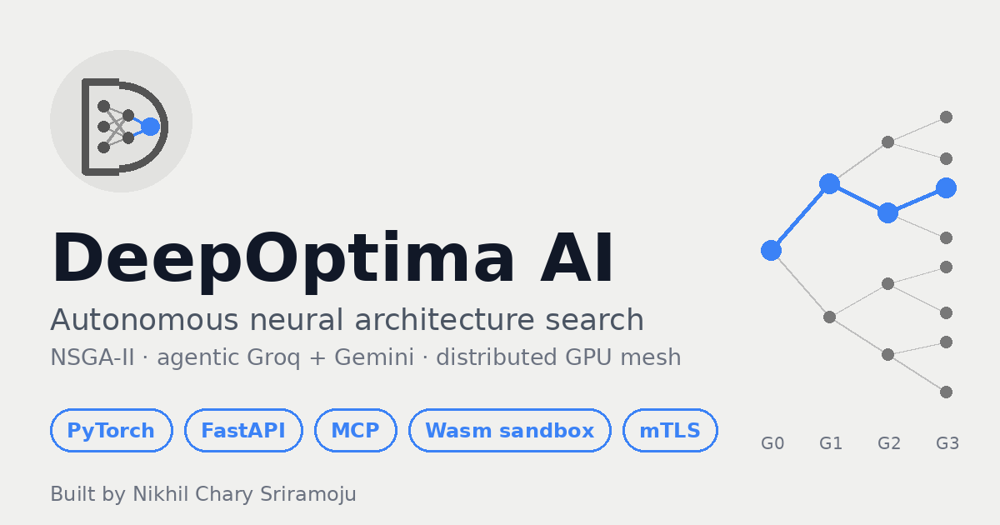
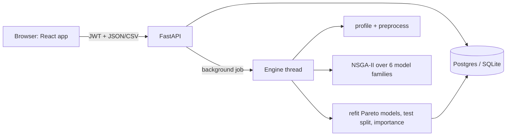

<p align="center"></p>

# DeepOptima Studio

**Free, private AutoML for your spreadsheets.** Create an account, upload a CSV, choose the column to predict, and a multi-objective evolutionary search (NSGA-II) tries hundreds of models for you, keeping the best trade-offs between **accuracy, prediction speed and model size**. Get honest test scores against a baseline, feature importance, a downloadable model plus a ready-to-run `predict.py`, online predictions and optional share links.

Built by [Nikhil Chary Sriramoju](https://github.com/Nikhil-creat). MIT license.

## What a user can do
1. **Sign up / sign in** (scrypt-hashed passwords, signed sessions, rate limiting, account deletion).
2. **Upload a CSV** (checked and profiled: column types, missing values, ID-like columns, warnings).
3. **Create an experiment**: target column, problem type (auto), scoring metric, model families (linear, tree, random forest, gradient boosting, neural network with architecture search, kNN), search budget, held-out test share, seed.
4. **Watch it run** in the background (progress, live chart of score vs speed vs size, cancel anytime).
5. **Use the results**: best models with *Most accurate / Fastest / Smallest* tags, baseline comparison, feature importance, download `model.joblib` + `predict.py`, predict one row or a whole CSV, share a read-only link.

## Quick start
```bash
# API + engine (SQLite), then the web app
cd backend && pip install -r requirements-studio.txt && uvicorn app.studio.main:app --reload --port 8000
cd frontend && npm install && VITE_API_URL=http://localhost:8000 npm run dev      # http://localhost:5173

# or everything in Docker with Postgres
make studio-docker                                                                  # http://localhost:8000
```
Put it online for free (Neon + Render, optional Vercel landing): **[docs/STUDIO_DEPLOY.md](docs/STUDIO_DEPLOY.md)**. What is left for you to do: **[docs/FINAL_CHECKLIST.md](docs/FINAL_CHECKLIST.md)**.

## How it works

Objectives (all optimised together): validation **score** ↑, **ms per 1,000 predictions** ↓, **file size** ↓. Final models are refit on train+validation and scored once on a test split that was never used for selection.

## Repository layout
```
backend/app/studio/      Studio API (auth, datasets, experiments, predict, share, admin), job runner, settings
backend/app/studio/engine/   profile.py · space.py (model families, mutation) · search.py (NSGA-II loop) · pareto.py · codegen.py
frontend/src/            App.tsx (router) · Landing.tsx (marketing page) · studio/ (pages, api client, charts)
backend/tests/           engine, security and API tests (run in CI)
Dockerfile.studio · docker-compose.studio.yml · render.yaml
backend/app/{nas,workers,agents,...}   research track: GPU neural-architecture-search mesh (Celery/PyTorch, MCP, Wasm); see docs/ARCHITECTURE.md
notebooks/deepoptima_colab.ipynb       GPU benchmark for the research track
```

## Honest status
- Engine, security helpers and the sample-data flow are tested here (real scikit-learn runs: wine, diabetes, a synthetic churn table: baseline 54% → 89%). The HTTP API, database layer and React screens were written carefully and type-checked, but their end-to-end test (`backend/tests/test_studio_api.py`) runs in CI, not in the sandbox that produced this code. Check GitHub Actions after your first push.
- Not included yet: email verification / password reset emails, payments, image / GPU training in the web app, multi-server job scaling.
- Models are statistical estimates; validate before important decisions.

## Research track (GPU mesh)
The earlier DeepOptima AI platform (distributed PyTorch NAS, agent swarm, MCP server, Wasm sandbox, mTLS) remains in the repo. See [docs/ARCHITECTURE.md](docs/ARCHITECTURE.md), [docs/DEPLOY_GUIDE.md](docs/DEPLOY_GUIDE.md) and the Colab notebook.

## Author
**Nikhil Chary Sriramoju** · B.Tech CSE (2027), Vaagdevi College of Engineering, Telangana · [LinkedIn](https://in.linkedin.com/in/nikhil-chary-sriramoju-95041b38a) · sriramojunikhil66@gmail.com
