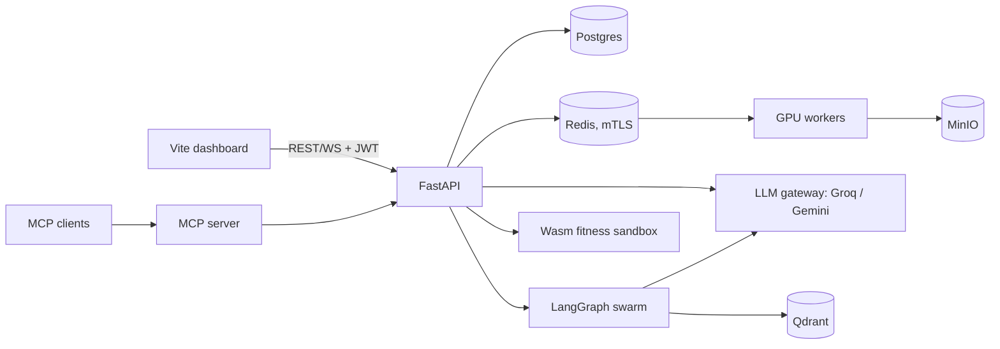

<p align="center"></p>

# DeepOptima AI

**Autonomous neural architecture search (NAS) and hyperparameter optimisation platform.**
Evolves CNN / ViT designs with NSGA-II (accuracy vs latency vs parameters), trains them on a distributed GPU worker mesh, and lets an agent swarm (Groq + Gemini) review failures.

> Live demo (in-browser simulator): deploy `frontend/` on Vercel · Real benchmark: run `notebooks/deepoptima_colab.ipynb` on a free T4 GPU.

## Highlights
- **Search engine:** block-based genotypes (conv, residual, MBConv, ViT), mutation + crossover, NSGA-II, zero-cost proxies, successive halving, adaptive operator selection.
- **Distributed:** FastAPI control plane, Celery GPU workers with checkpoint recovery and live heartbeats, MinIO artifacts (.pt / ONNX), Postgres metadata, Redis.
- **Agentic:** LangGraph swarm (tuning, security audit, efficiency) with Qdrant RAG; judge weights feed back into the search.
- **LLM gateway:** Groq (fast) + Gemini (deep), semantic cache, failover, **models auto-detected** and re-detected when retired.
- **Security:** JWT RBAC, mutual TLS to the broker, Fernet vault, hash-chained audit log with verification endpoint, rate limiting + lockout, CSP, prompt-injection screening, Wasm fitness sandbox (fuel + memory limited, no imports).
- **Free hosting path:** Vercel frontend + hosted assistant function, lightweight API on Render (Neon Postgres, Upstash Redis), GPU work on Colab. See `docs/FINAL_CHECKLIST.md`.
- **MCP server:** external LLM clients can audit trials and start searches.
- **Dashboard:** Vite + React + TypeScript + Tailwind, simulator mode, real-results mode (Colab session), live backend mode, AI assistant (voice, Telugu/English), dark mode.

## Quick start
```bash
# Frontend only (no backend needed)
cd frontend && npm install && npm run dev        # http://localhost:5173

# Full stack
cp .env.example .env                              # set JWT_SECRET, FERNET_KEY
docker compose up --build                         # API :8000/docs  UI :3000  MCP :8765
make ingest                                       # load research notes into Qdrant (agent RAG)
make mtls                                         # optional: mutual TLS to Redis

# Backend tests
cd backend && pip install -r requirements.txt pytest && pytest -q
```

## Architecture

More in [`docs/ARCHITECTURE.md`](docs/ARCHITECTURE.md), roadmap in [`docs/ROADMAP.md`](docs/ROADMAP.md).

## Repository layout
```
frontend/    Vite + React + TS + Tailwind (App.tsx holds the whole page)
backend/     FastAPI, NAS engine, workers, agents, MCP, tests, Alembic
notebooks/   deepoptima_colab.ipynb (real benchmark on a free GPU)
infra/       OpenTelemetry config, dev mTLS certificate script
docs/        architecture, deploy guide, launch kit, requirements
```

## Evidence and honesty
- The website dashboard defaults to a **simulated** fitness landscape; it illustrates the method.
- Real numbers come from the Colab notebook (same engine, real PyTorch training, evolution vs random search at equal budget). Add your own results here:

| Run | Evolution best acc | Random best acc | Settings |
|---|---|---|---|
| _(fill in after running the notebook)_ | | | POP / GENS / EPOCHS / TRAIN_N |

## Documentation
[`docs/FINAL_CHECKLIST.md`](docs/FINAL_CHECKLIST.md) · [`docs/DEPLOY_GUIDE.md`](docs/DEPLOY_GUIDE.md) · [`docs/LAUNCH_KIT.md`](docs/LAUNCH_KIT.md) · [`docs/REQUIREMENTS.md`](docs/REQUIREMENTS.md) · [`CHANGELOG.md`](CHANGELOG.md) · [`SECURITY.md`](SECURITY.md)

## Author
**Nikhil Chary Sriramoju**: B.Tech CSE (2027), Vaagdevi College of Engineering, Telangana, India.
[GitHub](https://github.com/Nikhil-creat) · [LinkedIn](https://in.linkedin.com/in/nikhil-chary-sriramoju-95041b38a) · sriramojunikhil66@gmail.com

MIT License.
