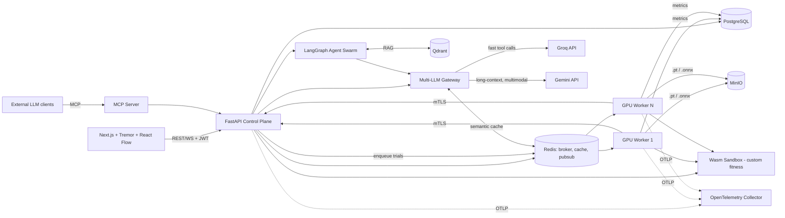

# DeepOptima AI - Architecture

## Data flow
1. User/agent creates an Experiment + SearchSpace via API or MCP.
2. Evolution engine samples a population of genotypes, writes Trials (status=queued).
3. Trials go to Celery (GPU queue). Worker builds the PyTorch phenotype, trains few epochs, streams metrics over Redis pub/sub, saves checkpoints to MinIO.
4. Results (accuracy, latency, params) land in Postgres; NSGA-II selects the next generation.
5. Failed trials go to the agent swarm: retrieve whitepapers from Qdrant, propose heuristic fixes via Groq/Gemini.
6. Dashboard consumes the WebSocket stream + Pareto endpoint.
